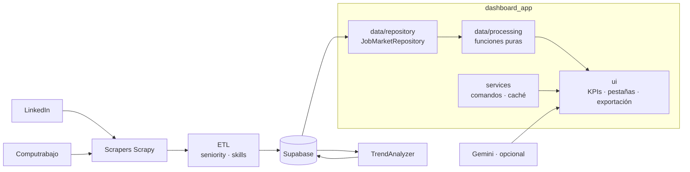

<p align="center"></p>

<h1 align="center">LatAm Insights</h1>

<p align="center"><b>From scattered job postings to useful insight on profiles, skills and sectors.</b></p>

<p align="center"><a href="https://proyecto-no-country-suy3cnnrkvzkdja5rfhovq.streamlit.app/"><b>Live demo ↗</b></a></p>

<p align="center"></p>

<p align="center">
     
</p>

<p align="center"><a href="https://dodysalim.github.io/"><b>🌐 Portfolio</b></a> · <a href="https://nocountry.tech/showcase/simulacion-laboral-noviembre-2025/equipo-27-datascience"><b>🏆 No Country Showcase</b></a> · <a href="README.md"><b>🇪🇸 Versión en español</b></a></p>

---

## 📌 At a glance

| | |
| --- | --- |
| **🎯 Problem** | Understand which skills and profiles data job postings ask for, and how they vary by location. |
| **🛠️ Solution** | LinkedIn and Computrabajo scrapers, ETL with seniority normalization and skill extraction. |
| **📈 Deliverables** | Layered dashboard (repository, pure processing, services, UI) with trends, filters and export. |
| **🧪 Quality** | 27 automated tests (ETL, reports and dashboard logic). |
| **👤 My role** | Data Analyst in a 3-person team. |

## 🏗️ Architecture



## 🚀 How to run

```bash
pip install -r requirements.txt
cp .env.example .env   # add SUPABASE_URL / SUPABASE_SERVICE_KEY
python -m streamlit run dashboard.py
python -m pytest tests -q
```

## ⚖️ Scope

Live scraping depends on sources, permissions and credentials; no job postings are fabricated.

## 👥 Team

Team: Juan (ML Engineer) · Rosa (Data Scientist) · Dody (Data Analyst). Collective authorship is preserved.

---

<p align="center">
<b>Dody Dueñas Remache</b> · Data Analyst / Data Scientist · Guayaquil, Ecuador (remote LATAM)<br>
<a href="https://dodysalim.github.io/">Portfolio</a> · <a href="https://github.com/dodysalim">GitHub</a> · <a href="https://www.linkedin.com/in/dody-duenas/">LinkedIn</a> · <a href="mailto:dodydurema67@gmail.com">dodydurema67@gmail.com</a>
</p>
